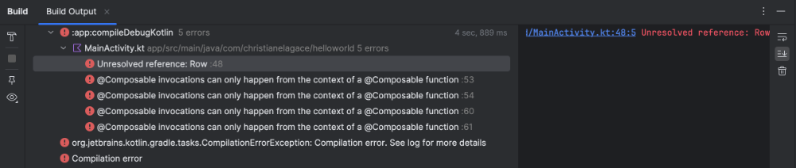
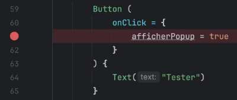
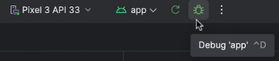
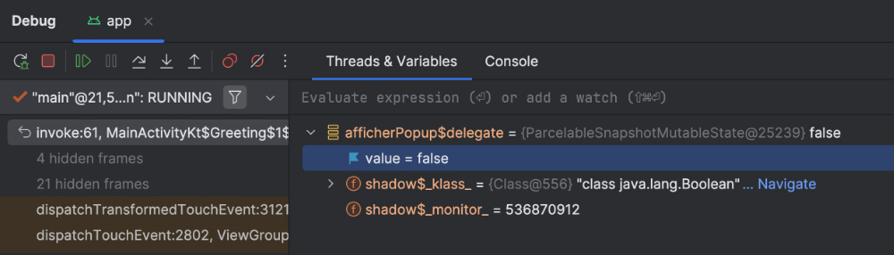
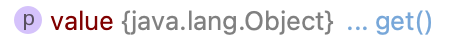
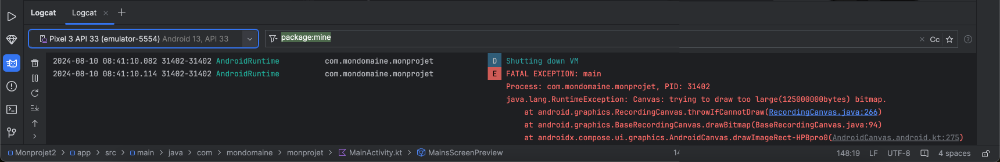
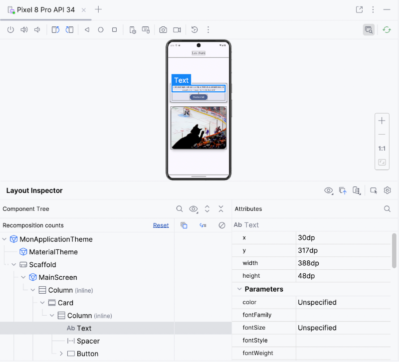

# Débogage et dépannage (Troubleshooting)

* [Debugger](#debugger)
* [Écrire dans Logcat](#logcat)
* [Déboguer une application qui se referme sans préavis](#app-crash)
* [Layout Inspector](#layout-inspector)


### 25.1 Atteindre rapidement la ligne qui cause une erreur de compilation


Quand votre application ne compile pas, Android Studio vous présente à prime abord un écran qui donne de l'information sur l'erreur. Il s'agit de l'onglet *Build* .


Il est possible à ce stade de cliquer sur une flèche pour déployer une section puis de double-cliquer sur une ligne pour atteindre directement le code en erreur.





### 25.2 Le débogueur d'Android Studio {#debugger}


Pour trouver ce qui ne fonctionne pas dans une application, il n'y a rien comme un débogueur. Et celui d'Android Studio travaille très bien!


#### Démarrer l'application en mode débogage

Vous pouvez placer un point d'arrêt dans votre code à l'endroit désiré en cliquant dans la marge gauche.





Pour que l'application puisse s'arrêter sur un point d'arrêt, elle doit avoir été lancée en mode débogage.


Une fois que vous avez **configuré un périphérique virtuel**, démarrez l'application en cliquant sur l'icône Debug .





Lorsque le programme atteint le point d'arrêt, vous pouvez :


- Consulter la valeur des variables dans la fenêtre Debug (si elle n'apparaît pas automatiquement, vous pouvez l'ouvrir par View / Tool Windows / Debug ).





- Entrer une expression à évaluer dans la zone Evaluate expression or add a watch .
- Exécuter les lignes une à la fois à l'aide des icônes Step Over , Step Into et Step Out .
- Modifier la valeur d'une variable.


### Connaître la valeur d'une variable


Dans certaines situations, le débogueur ne vous affichera pas la valeur d'une variable.


### Variables hors de portée


Comme dans tous les langages de programmation, le débogueur ne montrera que les variables visibles à l'endroit où le code s'est arrêté.


Même les variables d'état n'échappent pas à cette règle.


Si vous demandez d'évaluer une variable dans la zone *Evaluate expression or add a watch* et que cette variable est hors de portée, vous obtiendrez le message « Unresolved reference » ou « Cannot find local variable » ou encore « org.jetbrains.kotlin.backend.common.BackendException : Backend Internal error ».


### Variables avec un lien get()


Dans certaines situations, le débogueur vous affichera un lien get() à côté de la valeur d'une variable.





Cliquez sur ce lien afin d'obtenir la valeur.


#### Pour plus d'information
 * [« Debugging Jetpack Compose » - Youtube](https://www.youtube.com/watch?v=Kp-aiSU8qCU)

## 25.3 Écrire dans Logcat {#logcat}


Pour afficher une information dans la console d'Android Studio, la meilleure technique consiste à utiliser le système de journalisation (log).


Ceci permet de spécifier le niveau d'information (ex : DEBUG, INFO, WARNING, ERROR). De plus, il est possible de spécifier une étiquette (tag) qui sera affichée avant l'information afin de faciliter son repérage.


Vous utiliserez une de ces fonctions :

| Fonction | Niveau |
|----------|--------|
| Log.d() | Débogage |
| Log.i() | Information |
| Log.w() | Avertissement |
| Log.e() | Erreur |
| Log.v() | Verbose |
| Log.wtf() | Problème terrible |


Dans cet exemple, on utilise l'étiquette MainActivity pour afficher en mode débogage la valeur de la variable.


```kotlin title="Kotlin"
import android.util.Log
...
Log.d (" MainActivity ", maVariable )
```


Petit truc : pour mes informations de débogage, j'ajoute des astérisques devant l'étiquette pour que l'information soit plus facilement repérable.


```kotlin title="Kotlin"
import android.util.Log
...
Log.d (" *************** MainActivity ", maVariable )
```


Ouvrez l'onglet *Logcat* à l'aide du menu *View / Tool Windows / Logcat* ou en cliquant sur l'icône de chat au bas de l'écran.


Parmi toutes les informations journalisées, vous trouverez une ligne de ce genre :


```kotlin title="Résultat à l'écran (fenêtre Logcat)"
2025-08-25 11:47:40.977 8345-8365 EGL_emulation                 com.mondomaine.monapplication D app_time_stats: avg=29.85ms
min=2.16ms max=378.46ms count=27
2025-08-25 11:47:41.755 8345-8378 ProfileInstaller              com.mondomaine.monapplication D Installing profile for
com.mondomaine.devinette2025
2025-08-25 11:47:42.278 8345-8365 EGL_emulation                 com.mondomaine.monapplication D app_time_stats: avg=183.01ms
min=4.28ms max=516.29ms count=7
2025-08-25 11:47:43.607 8345-8365 EGL_emulation                 com.mondomaine.monapplication D app_time_stats: avg=442.87ms
min=332.95ms max=498.08ms count=3
2025-08-25 11:47:43.677 8345-8345  *************** MainActivity  com.mondomaine.monapplication D valeurDeMaVariable
2025-08-25 11:47:43.731 8345-8345 ImeTracker                   
com.mondomaine.monapplication I com.mondomaine.monapplication:f8b10efb: onRequestHide
at ORIGIN_CLIENT_HIDE_SOFT_INPUT reason HIDE_SOFT_INPUT_BY_INSETS_API
```


#### Pour plus d'information
 * [« How to Debug Jetpack Compose Recomposition with Logging? » - Vincent Tsen - AndroidDev Blog](https://vtsen.hashnode.dev/how-to-debug-jetpack-compose-)
recomposition-with-logging 

## 25.4 Déboguer une application qui se referme sans préavis


Pendant le développement de votre application Android avec Jetpack Compose, il peut arriver que lors de vos tests dans le simulateur, l'application se referme sans préavis.


Que faire alors pour trouver ce qui a causé le plantage?


La réponse se trouve dans le Logcat d'Android Studio. S'il n'est pas affiché, rendez-vous dans le menu *View / Tool Windows / Logcat* .


En faisant défiler l'écran, vous verrez une indication *FATAL EXCEPTION* qui donne des détails sur ce qui a fait planter l'application.





!!! info "Vous pouvez limiter l'affichage aux logs de niveau ERROR et plus en ajoutant *level:error* dans la zone de recherche.  Vous pouvez aussi arrêter l'affichage de nouveau logs en cliquant sur l'icône Pause."


### 25.5 Layout Inspector {#layout-inspector}

Quand vous développez une interface utilisateur avec Jetpack Compose, plusieurs facteurs peuvent venir influencer l'apparence et l'alignement des composables, par exemple :


- L'utilisation de composables d'alignement comme Row(), Column() ou Box()
- Les modifieurs appliqués aux composables d'alignement (ex : verticalAlignment = Alignment.Bottom)
- L'ordre dans lequel les modifieurs sont appliqués à un composable (ex : border avant ou après padding)
- Les espacements (ex : modifieurs des composables d'alignement, Spacer)

Afin de mieux visualiser l'emplacement de chaque composable, vous pouvez travailler avec le Layout Inspector d'Android Studio.


* Lancez l'application dans l'émulateur.
* Rendez vous dans le menu Tools / Layout Inspector 
* Un rectangle gris apparaîtra alentour de chaque composable afin d'indiquer ses limites. De plus, si vous sélectionnez un composable dans la hiérarchie présentée sous l'aperçu, vous le verrez entouré de bleu et ses attributs seront affichés.





> Pour revenir à l'affichage normal dans l'émulateur, refaites *Tools / Layout Inspector* .


#### Pour plus d'information


### * [« Déboguer votre mise en page avec l'outil d'inspection de la mise en page » - Android Developer](https://developer.android.com/studio/debug/layout-inspector?hl=fr)
